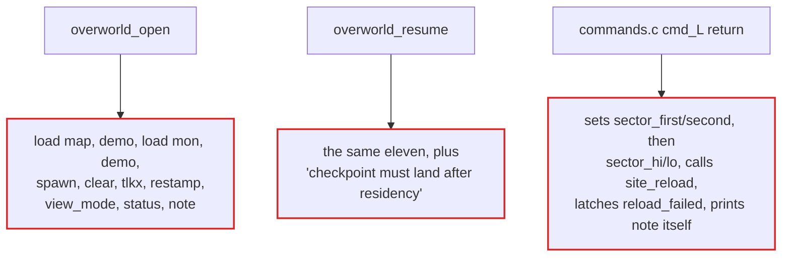
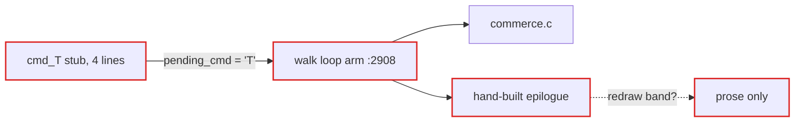
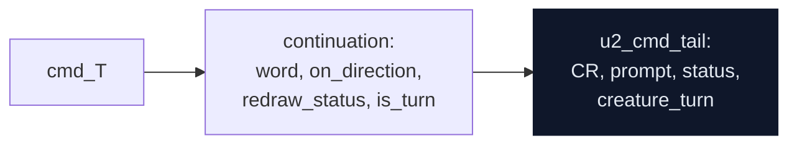
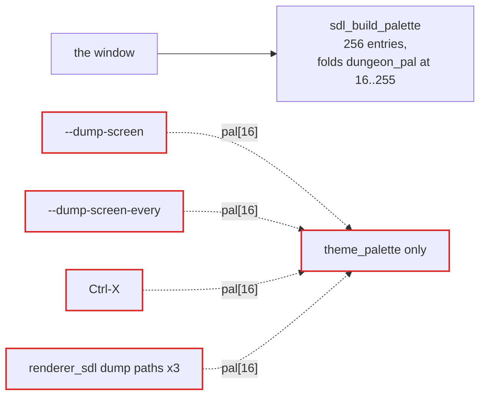
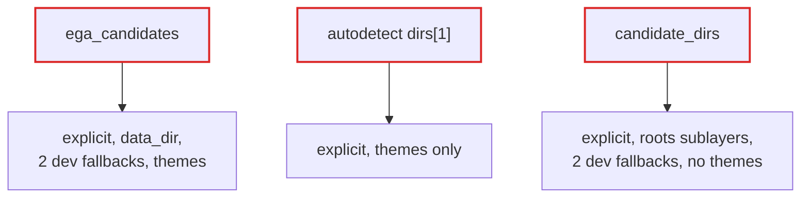
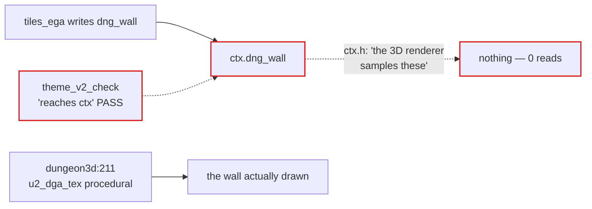

# Architecture review — 2026-11-21 — the Phase 4 engine

Status: **dated snapshot of one review pass, not a live queue.** It records what four
fresh-context explorers found in the engine's hot spots on 2026-11-21, with every claim
re-verified against the tree before it was written down. It is regenerable by re-running the
review against a later tree; it is not maintained by hand, and it must not be read as the
work queue. [`docs/outstanding.md`](outstanding.md) remains the authority on what is open,
and [`docs/needs-gameplay.md`](needs-gameplay.md) on what is blocked on play.

Vocabulary is the deep-module vocabulary: **module**, **interface**, **implementation**,
**depth** / deep / shallow, **seam**, **adapter**, **leverage**, **locality**. A module is
deep when a lot of behaviour sits behind a small interface, shallow when the interface is
nearly as complex as the implementation. The **deletion test**: imagine deleting the module —
if the complexity vanishes it was a pass-through, if it reappears across N callers it earned
its keep. The interface is the test surface: a test that has to reach past it means the module
is the wrong shape.

## Method and scope

Scope came from churn, because a deepening pays off in future changes to the module it
touches. Over the last 200 commits the hot spots were `engine/src/game/overworld.c` (25
touches), `engine/src/game/commands.c` (19), `engine/src/core/ctx.h` (10),
`engine/src/main.c` and `engine/src/game/space_view.c` (9 each), and the art / theme / tile
axis, which is most of the last forty commits.

Baseline shape, measured:

| header | lines | interface surface |
| --- | --- | --- |
| `engine/src/core/state.h` | 790 | 142 decls — but every field pinned by `_Static_assert` |
| `engine/src/core/ctx.h` | 526 | ~110 members, included by 60 translation units |
| `engine/src/game/overworld.h` | 464 | ~30 exports, implementation 3351 lines |
| `engine/src/game/commands.h` | 76 | 3 functions + 1 enum, implementation 2610 lines |
| `engine/src/platform/platform.h` | 190 | 4 vtables, 14 adapters |
| test suite | — | 48 C checks, 40 one-off Python drivers, 17 shell checkpoint scripts |

## What is already deep — do not re-suggest these

Several modules are exactly the shape the vocabulary asks for. A later review should not
spend its budget rediscovering them.

* **`core/state.h`** — the DS mirror is the one offset table, every named field pinned by
  `_Static_assert`, so a layout drift is a build failure. A deep interface with a mechanical
  gate.
* **`core/roots.c`** — one ordered table, four functions, `U2_ROOT_MAX` bounded by a static
  assert, and the header names the exact failure it prevents. `world.c`, `tiles.c` and
  `pic.c` all ask it. The slot-over-roots precedence is owned in one place.
* **`core/world.h`** — sector and dungeon addressing. There is **no file I/O at all in
  `engine/src/game/`** except one trace log, and every dungeon cell read goes through
  `u2_world_dungeon_at` / `_put` / `_terrain_put` across 18 call sites. The 16-wide paged-view
  hazard `AGENTS.md` names is structurally unreachable from the game layer.
* **`core/seam.h`** — 15 functions hiding four backend vtables plus tracing, and
  `tests/dirkey_check.c:41-53` exercises it with a fake `u2_input` adapter. The
  interface-as-test-surface pattern, already in use.
* **`core/view.c`**, **`core/scale.c`**, **`game/space.c`** (pure byte-in / byte-out, compiles
  alone — the model the others should copy), **`game/feedback.c`**, **`game/game.c`**.
* **The platform seam is real**: 4 vtables, 3 renderer adapters, 5 input, 3 audio, 3 clock,
  selected only in `main.c`. No game file calls SDL, `tcsetattr` or `clock()` directly.
  Capability is probed, not assumed — `renderer_term` and `renderer_null` omit `present_frame`,
  so the title flow falls back to text screens with no game-side branch.
* **`bot/target.py`** ships raw bytes at the engine's own decoder rather than parsing them,
  and says so. Two adapters, `EngineTarget` and `Spice86Target`, behind one interface.

---

## Candidate 1 — One sector-residency module

**Issue:** umbrella [#14](https://github.com/sloppy-seconds/ultima2-rebuild/issues/14)
**Files:** `engine/src/game/overworld.c:377-505`, `:1616-1783`, `:1784-1865` · `overworld.h:462` · `commands.c:1693-1725`
**Strength:** Strong

Two ~140-line functions perform the same ordered sequence, and a third copy lives as a
caller-side checklist. The source argues with itself about it: `overworld.c:1676` *"The other
of the two ways a sector becomes resident"*, `:1677` *"a fix in only one of them is the
mistake this project has now made twice with the restamp"*. `site_reload` is the only export
in `overworld.h` without the `u2_` prefix, and it is public only so `commands.c:1713` can
reach it; that caller's own comment enumerates the eight steps it is trusting.

**Problem.** The invariant that has produced the most repeat bugs in this tree has no module,
so every new caller — now three — re-derives it from a comment.

**Solution.** One residency module owning all steps, returning a verdict plus the note.
`overworld_open` keeps art loading and the prompt; `commands.c` calls the enter path.

**Wins.** One home for the restamp bug class · ~130 duplicated lines deleted · the ordering
contract stops being prose · `commands.c` stops reaching across the seam · residency becomes
testable in isolation.

**Deletion test.** Concentrates. The sequence exists twice inside one file plus once as a
checklist.

---

## Candidate 2 — The command tail: return a continuation, not a letter

**Issue:** umbrella [#14](https://github.com/sloppy-seconds/ultima2-rebuild/issues/14)
**Files:** `commands.c:308-538` · `commands.h:47-56` · `overworld.h:63` · `overworld.c:2862-3050`
**Strength:** Strong

Six of the 26 handlers are four-line stubs whose whole body is `str_out` + set `pending_cmd`
+ return `U2_CMD_AWAIT`. The other half of each command is a hand-written arm in the walk
loop — `overworld.c:2862` (U), `:2908` (T), `:2932` (S), `:2947` (O), `:2973` (F), `:3024`
(A) — each re-assembling the same epilogue by hand. The two decisions that differ are carried
in prose: TRANSACT redraws the band, STEAL deliberately does not.

Measured cost: `creature_turn` has **10 call sites** in the loop, each with its own proof
comment; `U2_S_CMD_PROMPT` is re-printed at **19 sites** while `echo_cmd` is used 8. To read
what `cmd_T` does you open six places across three modules.

**Problem.** The seam between the two hottest files is a magic byte plus an unwritten
ordering contract, so adding one direction-aimed command means editing both files and knowing,
per arm, whether the sweep and the band redraw run.

**Solution.** `U2_CMD_AWAIT` carries a continuation; one `u2_cmd_tail` owns CR / prompt /
status redraw / creature sweep, and the loop never switches on a letter.

**Wins.** Direction commands testable without the loop · six loop arms collapse to one · the
sweep rule gets a single home · a new aimed command edits one file.

**Deletion test.** The concept has no module today, so there is nothing to delete; introducing
the tail concentrates 6 stubs + 6 arms + 10 sweep sites. Opposite case found in passing:
`u2_overworld_run` (`overworld.c:2197-2201`) is a 4-line pass-through whose complexity
vanishes on deletion.

---

## Candidate 3 — Give the space screen a module

**Issue:** umbrella [#14](https://github.com/sloppy-seconds/ultima2-rebuild/issues/14)
**Files:** `commands.c:942-1903` (`space_loop` at `:1617`) · `game/space_view.h/c`
**Strength:** Strong

`commands.c` is 2610 lines. About **830 of them (32%)** are the plane / rocket / deep-space
screen, including a second event loop with its own `seam_key_poll` (`:1297`, `:1404`,
`:1654`), its own painter, its own sector reload and its own exit paths. This is why the
command module includes `core/frame.h`, `core/layout.h`, `core/font.h`, `game/space.h` and
`game/space_view.h` — none of which the 26-letter dispatch needs.

No test reaches it. Nothing calls `cmd_L`; `tests/space_view_gate.py:367,438` drives
`./u2 --script`, and `:92-113` asserts call ordering by **regexing the body of `space_loop`
out of `commands.c`** — a test reading C source because no interface can express "a frame was
presented between the prompt and the poll". Its own docstring admits one leg is untestable.

Meanwhile `space_view.h:189` documents `u2_space_scene_from` as *"Pure: reads, allocates
nothing, draws nothing"* — but `commands.c:1446-1474` overrides **six** fields before
drawing, including a NULL-means-hash convention explained over ten lines. A thin projection
whose output the caller must correct is the definition of shallow. Compare `dungeon.h:140`:
`u2_dungeon_render(ctx, ow, lit)` is one call that builds its own scan and dispatches to the
3D path. The caller says only "draw it".

**Solution.** Extract `game/flight.c` (loop, descent, warp driver) on top of the painter seam
`space_view` already provides, and make `u2_space_scene_from` return a *drawable* scene.

**Wins.** The space screen gains a testable interface · six caller knobs become zero · the
source-regex gate is deleted · frame / font / layout leave the command module.

**Deletion test.** The split earns its keep (a frame-free harness); the interface fails it.

---

## Candidate 4 — One active-palette resolver

**Issue:** [#9](https://github.com/sloppy-seconds/ultima2-rebuild/issues/9)
**Files:** `core/frame.c:472-575` · `platform/renderer_sdl.c:146, 395, 427, 477` · `game/overworld.c:2040, 3291, 3335`
**Strength:** Strong — the only candidate with user-visible wrong output today

`sdl_build_palette` exists specifically so two sites cannot drift — its comment says so — and
**six sites bypass it**, hand-building a 16-entry table from `ctx->theme_palette` alone.
`dungeon_assets.c:302-305` documents that the high-res sprite base images carry frame indices
16..255, and `frame.c:501,575` mask with `& 15`. So `--dump-screen`, `--dump-screen-every`
and Ctrl-X write a frame whose dungeon colours are silently aliased into the EGA 16 while the
window shows the 256-entry table. The screenshot a bug report is filed against is not the
image the player saw.

Compounding it: `frame.c` exports four writers — `write_ppm` / `write_ppm16` / `write_bmp` /
`write_bmp16` — each pair identical except the mask (`& 3` at `:482`/`:538`, `& 15` at
`:501`/`:575`), so every caller must also pick the right one.

**Solution.** `int u2_frame_active_palette(const u2_ctx *ctx, uint8_t out[256][3])` in
`frame.c`, one `u2_frame_write(f, path, pal, n_entries, fmt)`, delete the seven copies.

**Wins.** Dumps match the window again · ~90 duplicated lines deleted · the mask convention
stops being caller knowledge · `frame_check.c` can test the 256-entry path directly.

---

## Candidate 5 — One owner for art-directory precedence

**Issue:** [#10](https://github.com/sloppy-seconds/ultima2-rebuild/issues/10)
**Files:** `core/tiles_ega.c:483-503`, `:620-622` · `core/pic_ega.c:92-106` · `core/roots.c`
**Strength:** Strong

Three builders for "where is the EGA art", each a different subset of the real precedence.
This is not stylistic: `pic_ega.c:78-88` records an owner-reported bug caused by exactly this
divergence — *"the demo pictures are messed up in EGA mode"*, 2026-11-20 — because that
function read `ctx->data_dir` alone and missed the `data/original/` sublayer.
`tiles_ega.c:496-500` concedes the pair disagreed: *"an explicit request must never be worse
than an implicit one."* The autodetect name order is restated by hand in `tiles_ega.h:171-175`
and again in `install.c:725-727` — three copies of one rule.

**Solution.** `u2_art_dirs(ctx, dirs, max)` composed in `roots.c`, all three callers iterate
it, autodetect name order derived from the same place. Extend the deep module that exists;
do not layer a new tier on top.

**Wins.** Kills a proven bug class · ~30 lines out of each caller · one place to test the
order · dev-fallback policy in one guard.

---

## Candidate 6 — The seed seam does not exist

**Issue:** [#12](https://github.com/sloppy-seconds/ultima2-rebuild/issues/12) (blocked by #11)
**Files:** `engine/tests/*.py` · `tools/u2_edit.py:95-105` · `helm_map_check.c:36-79` and four siblings
**Strength:** Strong

There is no module for "put the engine into state X", so the DS record layout is independently
maintained in about eleven places.

| hand-maintained copy | count |
| --- | --- |
| test files writing `p[0x49 - 0x36]` | 8 |
| test files hand-building `bytearray(384)` creature records | 7 |
| test files hand-building `4096 + bytes(128)` sector files | 9 |
| a third offset convention (`OFF_SECTOR_HI = 0x13`, `site_viewport_gate.py:41-47`) | 1 |
| second full offset table (`u2_edit.py:98` `FIELDS`) | 1 |
| test files each re-`#define CHECK` | 37 |

`state.h:31-38` declares itself the one offset table and pins every field with
`_Static_assert`. It is the authority, and it is the only copy with a compile-time gate.

The C side has the same shape: `helm_map_check.c:36-79` hand-rolls a 5-function `u2_input`
adapter, a 2-function `u2_clock` adapter, `u2_vram_init` / `u2_state_init` / `u2_frame_init`
and a hand-filled 4096-byte map, and `commerce_check.c`, `death_check.c`, `dirkey_check.c`
and `keywait_check.c` each re-roll it. Consequence: **only 2 of 26 command handlers** are
reachable from a C test; the other 24 are covered by launching `./u2` once per letter and
grepping stdout. The ordering behaviours that actually break are not expressible through any
current test interface.

**Solution.** `engine/tests/u2_seed.py` with intent-level setters derived from `state.h`, plus
one shared C scenario fixture that arms a `u2_ctx` + `u2_overworld` + adapters in one call.

**Wins.** One offset table, not eleven · tests name intent, not bytes · 24 handlers reachable
without `./u2` · ~400 Python lines deleted · a field rename is one edit.

**Deletion test.** Passes with force: the byte literals cannot simply be deleted, which is the
signature of a missing module rather than dead code.

---

## Candidate 7 — `libu2.a` and one check harness

**Issue:** [#11](https://github.com/sloppy-seconds/ultima2-rebuild/issues/11)
**Files:** `engine/Makefile` (no `ar` target anywhere) · `engine/tests/run_cp*.sh`, `run_api.sh`, `run_demo.sh`
**Strength:** Strong

| repeated boilerplate | count |
| --- | --- |
| C check programs | 48 |
| compile lines hand-listing `src/core/*.c src/game/*.c src/debug/*.c` | 17 |
| `U2_CCFLAGS="$(make -s ccflags)"` | 8 scripts |
| `ok` / `bad` / `skip` defined | 12 scripts |
| `WORK=$(mktemp -d)` + `trap` | 10 scripts |
| compile → run → `sed` the verdict | ~40 |

**Problem.** The engine has no library interface, so every check re-declares how the engine is
built and how a verdict is read — a shallow surface repeated 48 times, and one where a check
can quietly drift to weaker flags than its neighbours.

**Solution.** `libu2.a` in the Makefile, one `engine/tests/harness.sh` with `ok` / `bad` /
`skip`, `compile_check`, `run_check`, `run_engine`, `seed`. ~600 shell lines deleted.

---

## Candidate 8 — Extract the CLI from `main()`

**Issue:** [#13](https://github.com/sloppy-seconds/ultima2-rebuild/issues/13)
**Files:** `main.c:43-288`, `:455-1537`, `:1436-1470` vs `game/game.c:186-196`
**Strength:** Strong, in two steps

`main()` spans ~1080 lines with ~70 direct `ctx.<member> =` writes, including parsing with
real failure modes (`--start-at X,Y[,SECTOR]`, `parse_rng_state`, `atoi` on three flags, the
`--enhanced` ⇒ EGA + `enhanced_layout` implication). Every refusal rule is tested by exec'ing
the binary and grepping stderr — `run_cp0.sh:396-398` matches `--script needs --headless`.

Separately and more urgently: `main.c:1436-1470` duplicates `game.c:186-196`'s death-reload
ordering, with the *"this ordering is the bug this gate exists"* comment written in both places.

**Solution.** Step 1, independently: delete the duplicated death loop in favour of
`u2_game_run`'s. Step 2: `u2_cli_parse(argc, argv, &ctx, &err)` returning a disposition, with
the flag table as data so `usage()` is generated from it.

---

## Candidate 9 — Delete the dead theme plumbing

**Issue:** [#7](https://github.com/sloppy-seconds/ultima2-rebuild/issues/7)
**Files:** `core/ctx.h:148-156` · `core/tiles_ega.c:323-340, 569-574` · `tests/theme_v2_check.c:220-226` · `tests/dungeon_art_neutral.py:33-38`
**Strength:** Strong

A theme key is parsed, plumbed through `ctx`, documented as load-bearing, and asserted by a
green test — and nothing reads it. `dungeon3d.c` contains **zero** references to `dng_wall`.
`scope_tower` is the same shape.

**Fix is deletion, not wiring.** `dungeon_art_neutral.py:33-38` forbids dungeon code from
naming `tiles_ega`, `scope_dungeon` or `art_index` at all, and its docstring records that the
in-game notice `THEME ART DOES NOT COVER DUNGEONS` was removed on 2026-11-06 *only because*
the dungeon is theme-free. Wiring would make that gate red by design and re-open a product
decision.

**Deletion test.** Complexity **vanishes** — the verdict this test exists to give, and the
pass-through it exists to catch.

---

## Candidate 10 — Test four deep little modules at their own interface

**Issue:** [#8](https://github.com/sloppy-seconds/ultima2-rebuild/issues/8)
**Files:** `core/roots.c` · `core/slot.c` · `core/copy.c` · `core/keys.c`
**Strength:** Strong

All four have **zero direct test hits**, and they carry load-bearing rules: layer order and
`release_only`; slot rotate / adopt legality ("a rotated world becomes a selectable save that
is really a corpse", `slot.h:104-115`); "a copy that cannot be proved is not a copy"
(`copy.h:38-40`); the key alphabet `--script` and the play API must agree on.

`run_api.sh:113` guards slot rotation with a **grep for the symbol name in source** — a gate
that cannot go red for a wrong-but-present function.

**Fix.** Four small `*_check.c` in the existing link style. No fakes, temp dirs only. All four
modules pass the deletion test cleanly; they are deep and small, simply untested at their own
boundary, which makes this the cheapest gap in the tree to close.

---

## Smaller findings, not carded

* **`ctx.h` is a mailbox as well as a context.** ~110 members in ~10 clusters, 60 translation
  units include it. `store_reason` is a `const char *` written at four sites so a log line can
  name the writer; `demo_world` is `const void *` because `ctx.h` cannot include `world.h`;
  `demo_quiescent_mode` is widened to `int` for the same reason; `demo_restamp_pending` is a
  flag standing in for a callback; `present_now` is the one genuine seam and **only 1 of 4
  view loops registers it**, leaving 18 hand-rolled compose-and-present sites with comments
  recording that the order has been got wrong. Enter through those four cheap sub-steps, not a
  split. Filed as [#2](https://github.com/sloppy-seconds/ultima2-rebuild/issues/2),
  [#3](https://github.com/sloppy-seconds/ultima2-rebuild/issues/3),
  [#4](https://github.com/sloppy-seconds/ultima2-rebuild/issues/4).
* **One owner for position, sector and view mode.** Three value pairs live twice with the copy
  direction decided per call site; `u2_overworld_draw` re-mirrors every frame and
  `demo_restamp_pending` exists solely to re-sync the other way. `overworld_resume:1793-1798`
  already records the silent-revert bug this produced. Belongs to candidate 1.
* **A demo inspection interface.** `demo.h` exports 20 functions and none reads a file back,
  so `demo_field.py` exists to read one DS byte — its own docstring records that every
  hand-written reader of the format got it wrong "in a way that produced a confident answer
  about the wrong bytes". `demo_mutate.py` re-implements the framing sha256.
* **The play API is observation-only.** Five commands; `run_api.sh` is the only test that uses
  it and never in a dungeon, in space, in a fight or a shop. ~19 Python drivers shell out with
  `--script` instead. A `seed` command built on candidate 6 is the smallest step.
* **`dg_set_transform` reads a global instead of its arguments.** `dungeon.c:683-691` saves,
  zeroes and restores `ctx->enhanced_layout` — documented as read once at launch — to steer a
  function it is already handing a destination frame.
* **Rule verdicts exported one at a time.** Several `overworld.h` exports exist only to make a
  rule assertable, yet the unlock defect that actually shipped — `tile_put` vs `terrain_put`
  erased by `creature_turn` — is unreachable from them. Extraction for testability without
  locality.
* **Two reader traps.** `bot/target_check.py:65-69` hand-writes a fourth copy of the DS
  offsets, contradicting what `bot/target.py:15` says must not exist
  ([#5](https://github.com/sloppy-seconds/ultima2-rebuild/issues/5)). `--dump-frame` is used
  by `run_cp7.sh:68` and appears nowhere in `usage()`
  ([#6](https://github.com/sloppy-seconds/ultima2-rebuild/issues/6)).

## Retracted during verification

An earlier draft claimed `run_cp5.sh:513-528` was a gate that could not fail. **It is not.**
The branch is `if [ ! -f src/game/combat.c ]` — the *skip* path — and `combat.c` exists, so
execution falls through to `combat_check` and its 52 checks over C1, C2 and C6 run on every
`make test`. The branch is dead shell that describes implemented work as unimplemented, which
is a reader trap and nothing more
([#1](https://github.com/sloppy-seconds/ultima2-rebuild/issues/1)). The generalisation is the
useful part: **a reviewer who reads a branch condition without reading which side of it
executes will report the polarity backwards, and it will look like a finding.**

## Top recommendation

**Candidate 1, the sector-residency module.** It is the only candidate where the code itself
names the failure it is preventing: the residency order has already been fixed in one of its
two copies twice, and the third copy lives as a caller's comment. The diff is contained — one
file plus one caller, no new seam, no new adapter — and it converts the tree's most repeated
bug class into a single interface.

If the afternoon is short: **candidate 9** (pure deletion, removes a false contract and a green
gate certifying a wire to nowhere), then **candidate 4** (the only user-visible wrong output).

Sequencing: **candidates 6 and 7** are what make 1–3 and 8 verifiable rather than merely
smaller. Do them alongside, not after.

## Issue map

| issue | candidate | label |
| --- | --- | --- |
| [#7](https://github.com/sloppy-seconds/ultima2-rebuild/issues/7) | 9 — delete dead theme plumbing | bug |
| [#8](https://github.com/sloppy-seconds/ultima2-rebuild/issues/8) | 10 — four small checks | enhancement |
| [#9](https://github.com/sloppy-seconds/ultima2-rebuild/issues/9) | 4 — active-palette resolver | bug |
| [#10](https://github.com/sloppy-seconds/ultima2-rebuild/issues/10) | 5 — art-directory precedence | bug |
| [#11](https://github.com/sloppy-seconds/ultima2-rebuild/issues/11) | 7 — `libu2.a` + harness | enhancement |
| [#12](https://github.com/sloppy-seconds/ultima2-rebuild/issues/12) | 6 — the seed seam (blocked by #11) | enhancement |
| [#13](https://github.com/sloppy-seconds/ultima2-rebuild/issues/13) | 8 — CLI extraction | enhancement |
| [#14](https://github.com/sloppy-seconds/ultima2-rebuild/issues/14) | 1, 2, 3 — umbrella | enhancement |
| [#15](https://github.com/sloppy-seconds/ultima2-rebuild/issues/15) | 1 — sector-residency module | child of #14 |
| [#16](https://github.com/sloppy-seconds/ultima2-rebuild/issues/16) | 2 — the command tail | child of #14 |
| [#17](https://github.com/sloppy-seconds/ultima2-rebuild/issues/17) | 3 — `game/flight.c` | child of #14 |
| [#1](https://github.com/sloppy-seconds/ultima2-rebuild/issues/1)–[#6](https://github.com/sloppy-seconds/ultima2-rebuild/issues/6) | the smaller findings above | mixed |

## Postscript — the interfaces got settled the same day

The grilling round after this review closed the open decisions, so the umbrella is no longer
holding undecided proposals. The rulings live on the issues and in
[`GLOSSARY.md`](../GLOSSARY.md); the short version:

* **The DS mirror owns position, sector and view mode.** The residency module publishes at one
  quiescent point through named accessors; the per-frame mirror and `demo_restamp_pending`'s
  re-sync are deleted, not documented.
* **Residency prints its own note and still returns a verdict**, because the message rule
  outranks purity and the existing checks already arm a frame.
* **A command continuation carries four fields and no more** — word, direction callback,
  redraw flag, turn flag. If the tail starts branching beyond those, the payload is wrong.
* **`flight.c` owns its loop and registers `present_now`**, and `u2_space_scene_from` becomes
  genuinely drawable instead of returning a half-built scene the caller corrects.
* **The seed module generates offsets from `state.h` and refuses to simulate.** No
  pathfinding, no legal-world synthesis, no save the original cannot load.

Order of attack, each its own commit: #13 step 1 (the duplicated death handoff), then #7, then
#15, then #11, then #12's Python half, then #16 and #17. #11 and #12 may run alongside #15.
